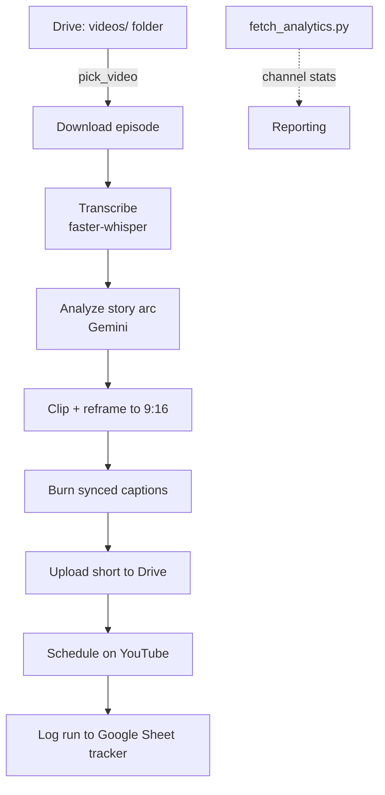

# shortgen

Automated viral-shorts generator that turns long-form TV series episodes into story-driven YouTube Shorts. Same engine as [shortgen-himym](https://github.com/rg-incognito/shortgen-himym), generalized to run against any source series.

## How it works

1. **Pick** — `drive_client.pick_video` selects the next un-processed episode from a Google Drive `videos/` folder, tracked via a Google Sheet so each episode is reused up to a max number of runs without repeating segments.
2. **Transcribe** — `transcriber.transcribe_video` runs `faster-whisper` to get word- and segment-level timestamps.
3. **Analyze** — `analyzer.analyze_transcript` sends the transcript to Gemini to find the best multi-clip story arc, avoiding previously used segments, and generates YouTube title/description/tags.
4. **Clip** — `clipper.create_story_short` cuts the selected segments and reframes each to vertical 9:16 with face/speaker-aware tracking, then burns in synced captions.
5. **Publish** — the short is uploaded to Drive, scheduled on YouTube, and the run is logged back to the tracker sheet. `fetch_analytics.py` separately pulls channel performance data for reporting.

A `local_test/` harness (`run.py` with sample `input/output` folders) lets the pipeline be exercised without touching Drive/YouTube.



## Architecture

| File | Role |
|---|---|
| `src/main.py` | Orchestrates the full pipeline end to end |
| `src/drive_client.py` | Google Drive download/upload, video picking, archiving |
| `src/transcriber.py` | Whisper-based transcription |
| `src/analyzer.py` | Gemini story-arc selection + YouTube metadata generation |
| `src/clipper.py` | Clip extraction, reframing, caption burn-in |
| `src/reframer.py` | Face/speaker-aware vertical reframing |
| `src/sheet_tracker.py` | Google Sheets-based run/segment tracker |
| `src/youtube_client.py` | Scheduled YouTube upload + playlist management |
| `fetch_analytics.py` | Pulls channel/video stats for the analytics dashboard |
| `local_test/` | Local run harness with sample input/output |

## Setup

```bash
pip install -r requirements.txt
python setup_oauth.py      # Drive OAuth
python setup_yt_oauth.py   # YouTube OAuth
python src/main.py
```

Requires `GOOGLE_SERVICE_ACCOUNT_JSON`, `GEMINI_API_KEY`, `SPREADSHEET_ID` env vars (`HF_TOKEN` optional, enables speaker diarization).
